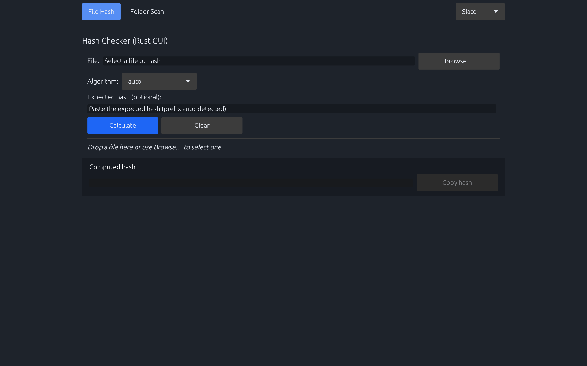

# Hash Checker

[](https://github.com/tamld/hash-checker/actions/workflows/ci.yml)


> Cross-platform integrity checker with a shared Rust core powering CLI and egui desktop apps.



Hash Checker delivers reproducible workflows for validating file hashes on Windows, macOS, and Linux. The project emphasises clean builds (Docker/Vagrant helpers) and an accessible GUI that mirrors the CLI feature set.

## Highlights
- Supports 8 digest algorithms (`SHA-256`, `SHA-512`, `SHA3-256`, `SHA3-512`, `BLAKE2b`, `BLAKE2s`, `SHA-1`, `MD5`) with automatic algorithm detection from hash prefixes across CLI and GUI.
- Shared Rust core exposes both command-line and `egui` desktop interfaces with real-time progress bars and cooperative **Cancel** controls.
- Batch comparison reports for CI: feed JSON/CSV definitions to `hash-checker batch` and export structured results with deterministic exit codes (`0`/`1`/`2`/`3`).
- Linux builds rely on the XDG desktop portal backend—no GTK runtime dependency for file dialogs by default, with optional `gtk4-native` support.
- Directory manifest export/verify with JSON, CSV, and TXT outputs and strict path-traversal protection (`normalize_manifest_rel_path`).
- Declarative SDD specifications (`specs/PRD.md`, `specs/SRS.md`, `specs/FSM.md`, `specs/AC.md`), `.g8s/feature-map.yml`, and Offer Bundle CI gates (`tools/ci_*.sh`).
- Accessibility extras: keyboard shortcuts, clipboard integration, and Soft Light / Slate / High Contrast Dark themes.

## Installation & Prebuilt Binaries

### 1. One-Line Standalone Install (CLI + GUI, SHA-256 Verified)
```bash
# macOS (Universal arm64 + x86_64) & Linux (x86_64) -> installs to ~/.local/bin
curl -fsSL https://raw.githubusercontent.com/tamld/hash-checker/main/scripts/install.sh | bash
```
```powershell
# Windows PowerShell (x86_64) -> installs to %LOCALAPPDATA%\Programs\hash-checker\bin
irm https://raw.githubusercontent.com/tamld/hash-checker/main/scripts/install.ps1 | iex
```

### 2. Native Desktop Setup & Portable Release Matrix ([GitHub Releases](https://github.com/tamld/hash-checker/releases))
| Platform | Portable Archive (CLI + GUI) | Native Desktop Setup / Package |
| :--- | :--- | :--- |
| **macOS** (`arm64` + `x86_64`) | `hash-checker_<version>_darwin_all.tar.gz` | `hash-checker.dmg` (Universal `.app` bundle) |
| **Linux** (`amd64`) | `hash-checker_<version>_linux_amd64.tar.gz` | `hash-checker-gui_<version>_amd64.deb`, `hash-checker-gui_<version>_x86_64.AppImage` |
| **Windows** (`amd64`) | `hash-checker_<version>_windows_amd64.zip` | `hash-checker-gui_<version>_x64-setup.exe` (NSIS Installer) |
| **Checksums** | `checksums.txt` / `SHA256SUMS` | Verify via `sha256sum -c checksums.txt --ignore-missing` |

### 3. Build & Install from Source
- Clone: `git clone https://github.com/tamld/hash-checker.git && cd hash-checker`
- Build local CLI + GUI into `./bin/`: `make local`
- Install to `~/.local/bin`: `make install`
- Verify SSoT version & SDD gates: `make verify-release`
- Container workflow: `make rust-test`, `make rust-gui-build`, `make rust-gui-smoke`, and `make cleanup-packaging`. See `docs/OPERATIONS.md` and `docs/RELEASE_SOP.md` for the full command matrix.
- Linux GUI runs via the XDG desktop portal. Install `xdg-desktop-portal` (and a backend such as `xdg-desktop-portal-gtk`) if your distro does not enable it by default.

## Documentation
- `docs/RELEASE_SOP.md` – release engineering, binary matrix, standalone installers, and SHA-256 verification SOP.
- `docs/OPERATIONS.md` – quick start, build/packaging commands, CI modes, Gatekeeper notes.
- `docs/PLAN.md` – roadmap and phase status.
- `docs/TASKS.md` – near-term work queue.
- `docs/BACKLOG.md` – longer-term ideas.
- `docs/security/VERIFICATION_GUIDE.md` – checksum, GPG, and Authenticode verification.
- `docs/GUI_SCREENSHOT.md` – screenshot checklist and gallery.

## Verify & Support
- Stable releases live on the [GitHub Releases page](https://github.com/tamld/hash-checker/releases). Installer and binary packages remain unsigned until SignPath onboarding completes.
- Follow `docs/security/VERIFICATION_GUIDE.md` to validate downloads; macOS Gatekeeper bypass commands are mirrored in `docs/OPERATIONS.md`.
- File bugs or feature requests through [GitHub Issues](https://github.com/tamld/hash-checker/issues) and reference the relevant documentation or `.agents/` notes for evidence.

## Status
- `main` is gated by `ci.yml` (fmt, clippy, unit tests, Docker builds, GUI smoke). Packaging jobs run via `release.yml` when preparing artefacts.
- Internal automation checklists and lessons live under the git-ignored `.agents/` workspace; sync them after every session.
