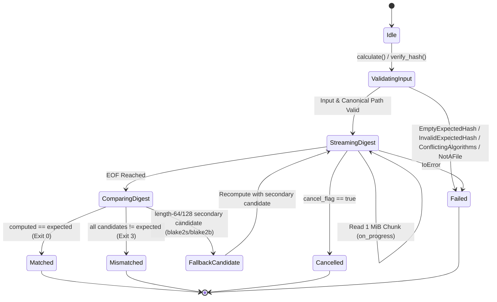

# Finite State Machine (FSM) Specifications — Hash Checker

**Status**: APPLIED  
**Version**: 1.0.0  
**Last Updated**: 2026-10-25

---

## 1. `FSM-01`: Single-File Hash & Verification Lifecycle



---

## 2. `FSM-02`: GUI & CLI Directory Manifest Lifecycle (`ManifestState`)

```mermaid
stateDiagram-v2
    [*] --> Empty
    Empty --> LoadingScan : trigger_scan(dir, algo, recursive)
    Empty --> LoadingVerify : trigger_verify(manifest_path)
    LoadingScan --> LoadingScan : on_progress(processed_files)
    LoadingVerify --> LoadingVerify : on_progress(processed_files)
    LoadingScan --> Ready : ManifestJobResult::Success
    LoadingVerify --> Ready : ManifestJobResult::Success
    LoadingScan --> Empty : User clicks Cancel (ManifestJobResult::Cancelled)
    LoadingVerify --> Empty : User clicks Cancel (ManifestJobResult::Cancelled)
    LoadingScan --> Error : ManifestJobResult::Failure
    LoadingVerify --> Error : ManifestJobResult::Failure
    Ready --> Exporting : trigger_export(json|csv|txt)
    Exporting --> Ready : Write complete / Banner updated
    Ready --> LoadingScan : Re-scan
    Ready --> LoadingVerify : Re-verify
    Error --> LoadingScan : Retry scan
    Error --> LoadingVerify : Retry verify
```

---

## 3. `FSM-03`: State Transition Contract Table

| FSM ID | Source State | Event / Trigger | Guard Condition | Target State | Output / Side Effect |
| :--- | :--- | :--- | :--- | :--- | :--- |
| `FSM-01` | `Idle` | `verify_hash(path, expected, algo)` | `expected.trim().is_empty()` | `Failed` | Returns `Err(HashError::EmptyExpectedHash)` |
| `FSM-01` | `ValidatingInput` | `verify_hash` | `flag != prefix` | `Failed` | Returns `Err(HashError::ConflictingAlgorithms)` |
| `FSM-01` | `StreamingDigest` | Chunk read loop | `cancel.load(Ordering::Relaxed)` | `Cancelled` | Returns `Err(HashError::Cancelled)` |
| `FSM-01` | `ComparingDigest` | Digest comparison | `computed == digest` | `Matched` | Returns `Ok((true, computed))` |
| `FSM-01` | `ComparingDigest` | Digest comparison | `computed != digest` | `Mismatched` | Returns `Ok((false, computed))` |
| `FSM-02` | `Empty` | `trigger_scan` | `selected_dir.is_some()` | `Loading(Scan)` | Spawns worker thread with `cancel_token` + `progress_counter` |
| `FSM-02` | `Loading(op)` | `cancel_active_job()` | `cancel_token.store(true)` | `Empty` | Sets info banner `"Operation cancelled."` and clears receiver |
| `FSM-02` | `Loading(op)` | `poll_job()` | `Ok(Success(ready))` | `Ready(ready)` | Updates summary counters and logs optional telemetry |
| `FSM-02` | `Loading(op)` | `poll_job()` | `Ok(Failure { .. })` | `Error(err)` | Renders error frame with details |
